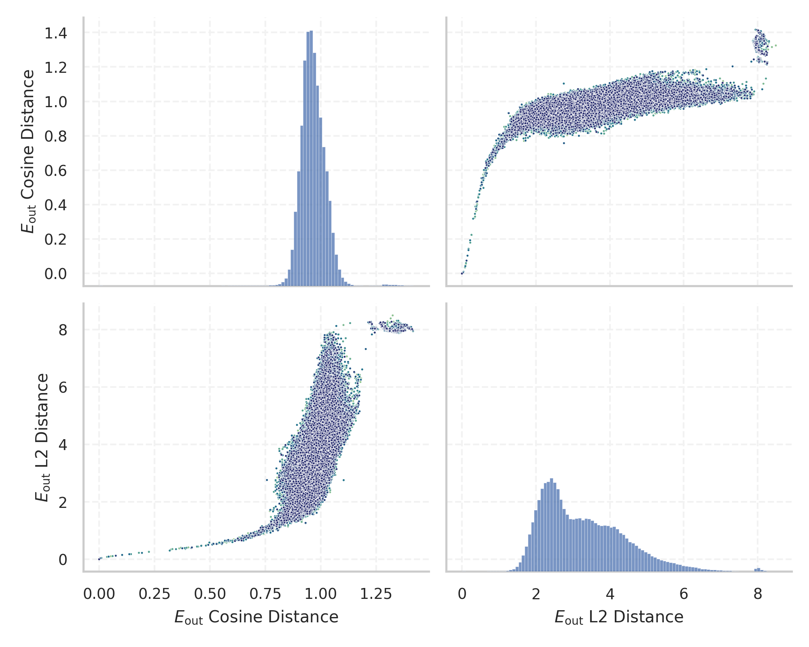
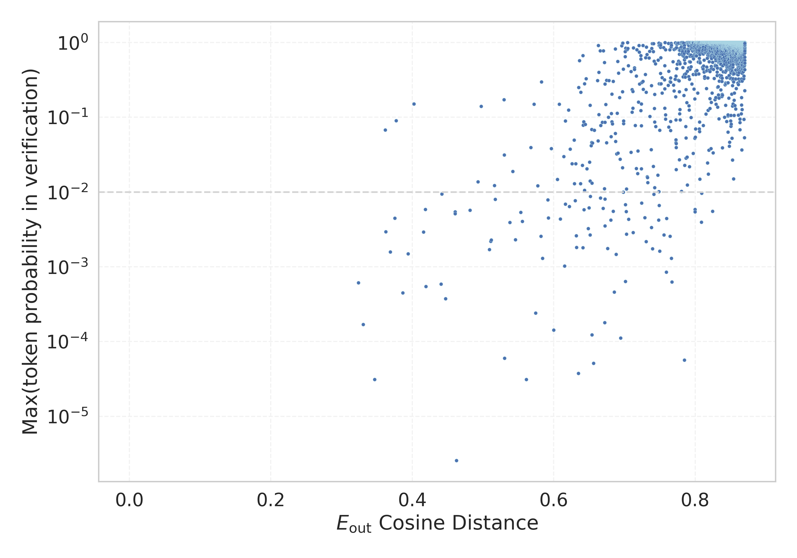

# Report for `CohereLabs/command-a-plus-05-2026-w4a4`

## Model info

* Model Info: 
  * Tied embeddings: True
  * LM head uses bias: False
  * Embeddings shape: [262144, 4096]
* Tokenizer Info: 
  * Vocab Size: 255032
  * Tokenizer Class: TokenizersBackend
  * Tokenizer Type: BPE
  * Bytes handling: Byte Input
  * Token for verification prompt building: abcdefghijklmnopqrstuvwxyz
  * Token id for verification prompt building: 173862
* Indicator summary: 
  * Indicator for under-trained tokens: E_{out} Cosine Distance
  * Overall distribution: 0.965 +/- 0.057
* Detected Token Counts: 
  * Number of tested under-trained tokens: 4980, 4940 non-special, 112 below p = 0.01 threshold, 54 below soft indicator threshold
  * Number of single byte tokens: 256, of which 13 below indicator threshold
  * Number of special tokens: 37, of which 22 below indicator threshold
  * Number of non-single-byte unreachable tokens: 7, of which 0 below indicator threshold
  * Number of non-single-byte UTF-fragment tokens:  6019, of which 3 below soft indicator threshold

## Under-trained token indicators plot


## Verification plot


## Under-trained token verification results
54 entries below threshold of 0.561

|   token_id | token                                                        |   indicator | in_other_tokens                                                                                                                                                                                                                                                                                                                                    | max_prob                                                         |
|------------|--------------------------------------------------------------|-------------|----------------------------------------------------------------------------------------------------------------------------------------------------------------------------------------------------------------------------------------------------------------------------------------------------------------------------------------------------|------------------------------------------------------------------|
|     232801 | ````` .ISUSAE `````                                          | 1.01328e-06 | <span style='border: 1px solid rgb(40, 167, 69);'>````` .ISUSAEJB `````</span>                                                                                                                                                                                                                                                                     |                                                                  |
|     204221 | ````` -COMFASTER `````                                       | 1.78814e-06 | <span style='border: 1px solid rgb(169, 68, 66);'>````` -COMFASTERXML `````</span>, <span style='border: 1px solid rgb(251, 189, 8);'>````` -COMFASTERXMLJACKSON `````</span>, <span style='border: 1px solid rgb(255, 145, 0);'>````` -COMFASTERXMLJACKSONCORE `````</span>                                                                       |                                                                  |
|     148541 | ````` renunciaop `````                                       | 3.93391e-06 | <span style='border: 1px solid rgb(255, 145, 0);'>````` ,orgpolrenunciaop `````</span>, <span style='border: 1px solid rgb(169, 68, 66);'>````` orenunciaop `````</span>, <span style='border: 1px solid rgb(169, 68, 66);'>````` polrenunciaop `````</span>, <span style='border: 1px solid rgb(255, 145, 0);'>````` ,aniorenunciaop `````</span> |                                                                  |
|     103639 | ````` eleavastr `````                                        | 4.35114e-06 | <span style='border: 1px solid rgb(40, 167, 69);'>````` eleavastrunic `````</span>                                                                                                                                                                                                                                                                 |                                                                  |
|      93131 | ````` -CBFIELD `````                                         | 0.00494796  | <span style='border: 1px solid rgb(169, 68, 66);'>````` -CBFIELDLENGTH `````</span>, <span style='border: 1px solid rgb(251, 189, 8);'>````` -CBFIELDNAME `````</span>                                                                                                                                                                             |                                                                  |
|     148550 | ````` orenunciaop `````                                      | 0.00531882  | <span style='border: 1px solid rgb(255, 145, 0);'>````` ,aniorenunciaop `````</span>                                                                                                                                                                                                                                                               |                                                                  |
|     148549 | ````` polrenunciaop `````                                    | 0.00931114  | <span style='border: 1px solid rgb(255, 145, 0);'>````` ,orgpolrenunciaop `````</span>                                                                                                                                                                                                                                                             |                                                                  |
|     125541 | ````` /$$+$$/$$+$$/$$+$$/$$+$$ `````                         | 0.0357652   | <span style='border: 1px solid rgb(169, 68, 66);'>````` /$$+$$/$$+$$/$$+$$/$$+$$/$$+$$/$$+$$/$$+$$/$$+$$ `````</span>                                                                                                                                                                                                                              |                                                                  |
|      77710 | ````` /$$+$$/$$+$$ `````                                     | 0.0430245   | <span style='border: 1px solid rgb(169, 68, 66);'>````` /$$+$$/$$+$$/$$+$$/$$+$$ `````</span>, <span style='border: 1px solid rgb(169, 68, 66);'>````` /$$+$$/$$+$$/$$+$$/$$+$$/$$+$$/$$+$$/$$+$$/$$+$$ `````</span>                                                                                                                               |                                                                  |
|     187376 | ````` ARMisa `````                                           | 0.0527653   |                                                                                                                                                                                                                                                                                                                                                    |                                                                  |
|      76957 | ````` /$$+$$ `````                                           | 0.0608422   | <span style='border: 1px solid rgb(169, 68, 66);'>````` /$$+$$/$$+$$/$$+$$/$$+$$ `````</span>, <span style='border: 1px solid rgb(169, 68, 66);'>````` /$$+$$/$$+$$ `````</span>, <span style='border: 1px solid rgb(169, 68, 66);'>````` /$$+$$/$$+$$/$$+$$/$$+$$/$$+$$/$$+$$/$$+$$/$$+$$ `````</span>                                            |                                                                  |
|     204726 | ````` /$$+$$/$$+$$/$$+$$/$$+$$/$$+$$/$$+$$/$$+$$/$$+$$ ````` | 0.0750783   |                                                                                                                                                                                                                                                                                                                                                    |                                                                  |
|     189652 | ````` ▁SDGAIcon `````                                        | 0.103873    |                                                                                                                                                                                                                                                                                                                                                    |                                                                  |
|     176300 | ````` .persosa `````                                         | 0.136214    |                                                                                                                                                                                                                                                                                                                                                    |                                                                  |
|     169494 | ````` persosa `````                                          | 0.193339    | <span style='border: 1px solid rgb(169, 68, 66);'>````` .persosa `````</span>                                                                                                                                                                                                                                                                      |                                                                  |
|     218729 | ````` xltw `````                                             | 0.318512    | <span style='border: 1px solid rgb(40, 167, 69);'>````` /NMZxltw `````</span>                                                                                                                                                                                                                                                                      |                                                                  |
|     189786 | ````` _BUJANG `````                                          | 0.323882    |                                                                                                                                                                                                                                                                                                                                                    | <span style='border: 1px solid rgb(169, 68, 66);'>0.00061</span> |
|     250036 | ````` peerachat `````                                        | 0.346804    |                                                                                                                                                                                                                                                                                                                                                    | <span style='border: 1px solid rgb(169, 68, 66);'>3.1e-05</span> |
|     135684 | ````` metappa `````                                          | 0.361816    |                                                                                                                                                                                                                                                                                                                                                    | <span style='border: 1px solid rgb(251, 189, 8);'>0.068</span>   |
|     148556 | ````` ,orgpolrenunciaop `````                                | 0.362655    |                                                                                                                                                                                                                                                                                                                                                    | <span style='border: 1px solid rgb(255, 145, 0);'>0.003</span>   |
<details><summary>34 additional entries below threshold</summary>

|   token_id | token                                                                                                                |   indicator | max_prob                                                         | in_other_tokens                                                                                                                                                                                                                                                                                                                                                                                                                     |
|------------|----------------------------------------------------------------------------------------------------------------------|-------------|------------------------------------------------------------------|-------------------------------------------------------------------------------------------------------------------------------------------------------------------------------------------------------------------------------------------------------------------------------------------------------------------------------------------------------------------------------------------------------------------------------------|
|     148557 | ````` ,aniorenunciaop `````                                                                                          |    0.375194 | <span style='border: 1px solid rgb(255, 145, 0);'>0.0045</span>  |                                                                                                                                                                                                                                                                                                                                                                                                                                     |
|     135682 | ````` ▁metappa `````                                                                                                 |    0.377271 | <span style='border: 1px solid rgb(251, 189, 8);'>0.09</span>    |                                                                                                                                                                                                                                                                                                                                                                                                                                     |
|     220451 | ````` {xcodeproj `````                                                                                               |    0.38641  | <span style='border: 1px solid rgb(169, 68, 66);'>0.00045</span> |                                                                                                                                                                                                                                                                                                                                                                                                                                     |
|     212988 | ````` %)*\| `````                                                                                                    |    0.388985 |                                                                  |                                                                                                                                                                                                                                                                                                                                                                                                                                     |
|     205374 | ````` disassembledata `````                                                                                          |    0.394233 | <span style='border: 1px solid rgb(255, 145, 0);'>0.0015</span>  | <span style='border: 1px solid rgb(255, 145, 0);'>````` ▁lastdisassembledata `````</span>                                                                                                                                                                                                                                                                                                                                           |
|     254825 | ````` /covetus `````                                                                                                 |    0.402481 | <span style='border: 1px solid rgb(40, 167, 69);'>0.15</span>    |                                                                                                                                                                                                                                                                                                                                                                                                                                     |
|     147935 | ````` \t\t\t\n\t\t\n\t\t\n\t\t\t\n\t\t\n\t\t\n `````                                                                 |    0.415729 | <span style='border: 1px solid rgb(255, 145, 0);'>0.0029</span>  | <span style='border: 1px solid rgb(251, 189, 8);'>````` \t\t\t\n\t\t\n\t\t\n\t\t\t\n\t\t\n\t\t\n\t\t\t\n\t\t\n\t\t\n\t\t\t\n\t\t\n\t\t\n `````</span>                                                                                                                                                                                                                                                                               |
|     202457 | ````` %----%---- `````                                                                                               |    0.418437 | <span style='border: 1px solid rgb(255, 145, 0);'>0.0059</span>  |                                                                                                                                                                                                                                                                                                                                                                                                                                     |
|     161232 | ````` `PCT `````                                                                                                     |    0.419124 | <span style='border: 1px solid rgb(169, 68, 66);'>0.00055</span> |                                                                                                                                                                                                                                                                                                                                                                                                                                     |
|      93386 | ````` unciaop `````                                                                                                  |    0.440743 | <span style='border: 1px solid rgb(169, 68, 66);'>0.00059</span> | <span style='border: 1px solid rgb(255, 145, 0);'>````` ,orgpolrenunciaop `````</span>, <span style='border: 1px solid rgb(169, 68, 66);'>````` orenunciaop `````</span>, <span style='border: 1px solid rgb(169, 68, 66);'>````` polrenunciaop `````</span>, <span style='border: 1px solid rgb(255, 145, 0);'>````` ,aniorenunciaop `````</span>, <span style='border: 1px solid rgb(169, 68, 66);'>````` renunciaop `````</span> |
|     107998 | ````` TRIVIABOT `````                                                                                                |    0.441696 | <span style='border: 1px solid rgb(255, 145, 0);'>0.0094</span>  |                                                                                                                                                                                                                                                                                                                                                                                                                                     |
|     183830 | ````` ▁timinglib `````                                                                                               |    0.447119 | <span style='border: 1px solid rgb(169, 68, 66);'>0.00037</span> |                                                                                                                                                                                                                                                                                                                                                                                                                                     |
|     195358 | ````` _AWSEC `````                                                                                                   |    0.460652 | <span style='border: 1px solid rgb(255, 145, 0);'>0.0054</span>  |                                                                                                                                                                                                                                                                                                                                                                                                                                     |
|     167720 | ````` OCESQL `````                                                                                                   |    0.460675 | <span style='border: 1px solid rgb(255, 145, 0);'>0.0052</span>  |                                                                                                                                                                                                                                                                                                                                                                                                                                     |
|     149911 | ````` %)\x08\x08\x08\x08\x08\x08\x08\x08\x08\x08\x08\x08\x08\x08\x08\x08 `````                                       |    0.462291 | <span style='border: 1px solid rgb(169, 68, 66);'>2.6e-06</span> | <span style='border: 1px solid rgb(40, 167, 69);'>````` %)\x08\x08\x08\x08\x08\x08\x08\x08\x08\x08\x08\x08\x08\x08\x08\x08\x08 `````</span>                                                                                                                                                                                                                                                                                         |
|     223344 | ````` ▁lastdisassembledata `````                                                                                     |    0.481674 | <span style='border: 1px solid rgb(255, 145, 0);'>0.0057</span>  |                                                                                                                                                                                                                                                                                                                                                                                                                                     |
|     145895 | ````` -CBFIELDLENGTH `````                                                                                           |    0.487886 |                                                                  |                                                                                                                                                                                                                                                                                                                                                                                                                                     |
|     233734 | ````` \t\t\t\n\t\t\n\t\t\n\t\t\t\n\t\t\n\t\t\n\t\t\t\n\t\t\n\t\t\n\t\t\t\n\t\t\n\t\t\n `````                         |    0.49271  | <span style='border: 1px solid rgb(251, 189, 8);'>0.014</span>   |                                                                                                                                                                                                                                                                                                                                                                                                                                     |
|     115995 | ````` \|:--\|:--\|:--\|:--\|:--\|:--\|:--\|:-- `````                                                                 |    0.509071 | <span style='border: 1px solid rgb(255, 145, 0);'>0.0017</span>  | <span style='border: 1px solid rgb(255, 145, 0);'>````` \|:--\|:--\|:--\|:--\|:--\|:--\|:--\|:--\|:--\|:--\|:--\|:-- `````</span>                                                                                                                                                                                                                                                                                                   |
|     153252 | ````` ▁▁▁▁▁▁▁▁▁▁▁▁\n▁▁▁▁▁▁▁▁▁▁▁▁▁▁▁▁\n▁▁▁▁▁▁▁▁▁▁▁▁▁▁▁▁\n▁▁▁▁▁▁▁▁▁▁▁▁\n▁▁▁▁▁▁▁▁▁▁▁▁▁▁▁▁\n▁▁▁▁▁▁▁▁▁▁▁▁▁▁▁▁\n `````     |    0.510898 | <span style='border: 1px solid rgb(255, 145, 0);'>0.0022</span>  | <span style='border: 1px solid rgb(251, 189, 8);'>````` ▁▁▁▁▁▁▁▁▁▁▁▁\n▁▁▁▁▁▁▁▁▁▁▁▁▁▁▁▁\n▁▁▁▁▁▁▁▁▁▁▁▁▁▁▁▁\n▁▁▁▁▁▁▁▁▁▁▁▁\n▁▁▁▁▁▁▁▁▁▁▁▁▁▁▁▁\n▁▁▁▁▁▁▁▁▁▁▁▁▁▁▁▁\n▁▁▁▁▁▁▁▁▁▁▁▁\n▁▁▁▁▁▁▁▁▁▁▁▁▁▁▁▁\n▁▁▁▁▁▁▁▁▁▁▁▁▁▁▁▁\n▁▁▁▁▁▁▁▁▁▁▁▁\n▁▁▁▁▁▁▁▁▁▁▁▁▁▁▁▁\n▁▁▁▁▁▁▁▁▁▁▁▁▁▁▁▁\n `````</span>                                                                                                                                                       |
|     157240 | ````` >isnpolyh `````                                                                                                |    0.511716 | <span style='border: 1px solid rgb(255, 145, 0);'>0.0023</span>  |                                                                                                                                                                                                                                                                                                                                                                                                                                     |
|     150520 | ````` -CBFIELDNAME `````                                                                                             |    0.516031 | <span style='border: 1px solid rgb(251, 189, 8);'>0.012</span>   |                                                                                                                                                                                                                                                                                                                                                                                                                                     |
|     182052 | ````` _petreg `````                                                                                                  |    0.517157 | <span style='border: 1px solid rgb(255, 145, 0);'>0.008</span>   |                                                                                                                                                                                                                                                                                                                                                                                                                                     |
|     156237 | ````` %)\x08\x08\x08\x08\x08\x08\x08\x08\x08\x08\x08\x08\x08\x08\x08\x08\x08 `````                                   |    0.529669 | <span style='border: 1px solid rgb(40, 167, 69);'>0.17</span>    |                                                                                                                                                                                                                                                                                                                                                                                                                                     |
|     217146 | ````` \|--:\|--:\|--:\|--: `````                                                                                     |    0.529955 | <span style='border: 1px solid rgb(251, 189, 8);'>0.031</span>   |                                                                                                                                                                                                                                                                                                                                                                                                                                     |
|     246600 | ````` -EDNAME `````                                                                                                  |    0.530341 | <span style='border: 1px solid rgb(169, 68, 66);'>6e-05</span>   |                                                                                                                                                                                                                                                                                                                                                                                                                                     |
|     247663 | ````` \|:--:\|:--:\|:--:\|:--:\|:--:\|:--:\|:--:\|:--: `````                                                         |    0.538133 | <span style='border: 1px solid rgb(255, 145, 0);'>0.0039</span>  |                                                                                                                                                                                                                                                                                                                                                                                                                                     |
|     103251 | ````` ▁▁▁▁\n\n▁▁▁▁\n▁▁▁▁\n▁▁▁▁▁▁▁▁\n▁▁▁▁\n▁▁▁▁▁▁▁▁\n▁▁▁▁\n▁▁▁▁\n\n▁▁▁▁\n▁▁▁▁\n▁▁▁▁▁▁▁▁\n▁▁▁▁\n▁▁▁▁▁▁▁▁\n▁▁▁▁\n ````` |    0.542088 | <span style='border: 1px solid rgb(251, 189, 8);'>0.019</span>   | <span style='border: 1px solid rgb(251, 189, 8);'>````` ▁▁▁▁\n\n▁▁▁▁\n▁▁▁▁\n▁▁▁▁▁▁▁▁\n▁▁▁▁\n▁▁▁▁▁▁▁▁\n▁▁▁▁\n▁▁▁▁\n\n▁▁▁▁\n▁▁▁▁\n▁▁▁▁▁▁▁▁\n▁▁▁▁\n▁▁▁▁▁▁▁▁\n▁▁▁▁\n▁▁▁▁\n\n▁▁▁▁\n▁▁▁▁\n▁▁▁▁▁▁▁▁\n▁▁▁▁\n▁▁▁▁▁▁▁▁\n▁▁▁▁\n▁▁▁▁\n\n▁▁▁▁\n▁▁▁▁\n▁▁▁▁▁▁▁▁\n▁▁▁▁\n▁▁▁▁▁▁▁▁\n▁▁▁▁\n `````</span>                                                                                                                                               |
|     146882 | ````` ▁libsynt `````                                                                                                 |    0.545795 | <span style='border: 1px solid rgb(255, 145, 0);'>0.0023</span>  |                                                                                                                                                                                                                                                                                                                                                                                                                                     |
|     136166 | ````` -NAMEFIELD `````                                                                                               |    0.553203 | <span style='border: 1px solid rgb(255, 145, 0);'>0.0054</span>  |                                                                                                                                                                                                                                                                                                                                                                                                                                     |
|     204229 | ````` -COMFASTERXML `````                                                                                            |    0.553941 |                                                                  | <span style='border: 1px solid rgb(251, 189, 8);'>````` -COMFASTERXMLJACKSON `````</span>, <span style='border: 1px solid rgb(255, 145, 0);'>````` -COMFASTERXMLJACKSONCORE `````</span>                                                                                                                                                                                                                                            |
|     225427 | ````` .redditcfb `````                                                                                               |    0.554202 |                                                                  |                                                                                                                                                                                                                                                                                                                                                                                                                                     |
|     241370 | ````` _Prescl `````                                                                                                  |    0.555801 | <span style='border: 1px solid rgb(255, 145, 0);'>0.004</span>   |                                                                                                                                                                                                                                                                                                                                                                                                                                     |
|     242356 | ````` NULSd `````                                                                                                    |    0.5559   |                                                                  |                                                                                                                                                                                                                                                                                                                                                                                                                                     |
</details>


## Tokens with partial UTF-8 sequences
3 entries below threshold of 0.561

|   token_id | token                      |   indicator | in_other_tokens                                                                                         |
|------------|----------------------------|-------------|---------------------------------------------------------------------------------------------------------|
|        544 | ````` о<0xD0> `````        | 2.98023e-07 | ````` ▁конц `````, ````` ▁попол `````, ````` ▁собра `````, ````` оном `````, ````` ▁проходят `````, ... |
|      71186 | ````` <0x8C><0x93>글 ````` | 1.66893e-06 | ````` 댓글 `````, ````` ▁댓글이 `````, ````` ▁댓글 `````                                                |
|      93221 | ````` <0xA2>nh `````       | 0.143765    | ````` ▁Ảnh `````, ````` Ảnh `````                                                                       |


## Byte tokens
13 entries below threshold of 0.614

|   token_id | token              |   indicator |   ord | hex   | byte_type   |
|------------|--------------------|-------------|-------|-------|-------------|
|        189 | ````` <0xFC> ````` | 2.98023e-07 |   252 | 0xFC  | unused_utf8 |
|        182 | ````` <0xF5> ````` | 4.17233e-07 |   245 | 0xF5  | unused_utf8 |
|        190 | ````` <0xFD> ````` | 8.9407e-07  |   253 | 0xFD  | unused_utf8 |
|        188 | ````` <0xFB> ````` | 1.07288e-06 |   251 | 0xFB  | unused_utf8 |
|        129 | ````` <0xC0> ````` | 1.3113e-06  |   192 | 0xC0  | unused_utf8 |
|        185 | ````` <0xF8> ````` | 1.43051e-06 |   248 | 0xF8  | unused_utf8 |
|        130 | ````` <0xC1> ````` | 1.43051e-06 |   193 | 0xC1  | unused_utf8 |
|        186 | ````` <0xF9> ````` | 1.43051e-06 |   249 | 0xF9  | unused_utf8 |
|        184 | ````` <0xF7> ````` | 1.49012e-06 |   247 | 0xF7  | unused_utf8 |
|        192 | ````` <0xFF> ````` | 1.54972e-06 |   255 | 0xFF  | unused_utf8 |
|        183 | ````` <0xF6> ````` | 1.78814e-06 |   246 | 0xF6  | unused_utf8 |
|        187 | ````` <0xFA> ````` | 1.90735e-06 |   250 | 0xFA  | unused_utf8 |
|        191 | ````` <0xFE> ````` | 2.20537e-06 |   254 | 0xFE  | unused_utf8 |


## Special tokens
22 entries below threshold of 0.614

|   token_id | token                               |    indicator | max_prob                                                         |
|------------|-------------------------------------|--------------|------------------------------------------------------------------|
|     255020 | ````` <\|USER_2_TOKEN\|> `````      | -2.38419e-07 |                                                                  |
|     255023 | ````` <\|USER_5_TOKEN\|> `````      |  0           |                                                                  |
|     255019 | ````` <\|USER_1_TOKEN\|> `````      |  6.55651e-07 |                                                                  |
|     255021 | ````` <\|USER_3_TOKEN\|> `````      |  8.9407e-07  |                                                                  |
|     255005 | ````` <\|NEW_FILE\|> `````          |  8.9407e-07  |                                                                  |
|     255022 | ````` <\|USER_4_TOKEN\|> `````      |  9.53674e-07 |                                                                  |
|     255024 | ````` <\|USER_6_TOKEN\|> `````      |  9.53674e-07 |                                                                  |
|     255025 | ````` <\|USER_7_TOKEN\|> `````      |  1.07288e-06 |                                                                  |
|     255031 | ````` <\|IMG_PATCH\|> `````         |  1.07288e-06 |                                                                  |
|     255027 | ````` <\|USER_9_TOKEN\|> `````      |  1.3113e-06  |                                                                  |
|     255018 | ````` <\|USER_0_TOKEN\|> `````      |  1.3113e-06  |                                                                  |
|     255026 | ````` <\|USER_8_TOKEN\|> `````      |  1.54972e-06 |                                                                  |
|          1 | ````` <MASK_TOKEN> `````            |  0.0116054   |                                                                  |
|     255029 | ````` <\|END_OF_IMG\|> `````        |  0.179451    |                                                                  |
|     255030 | ````` <\|IMG_LINE_BREAK\|> `````    |  0.223513    |                                                                  |
|     255028 | ````` <\|START_OF_IMG\|> `````      |  0.224731    |                                                                  |
|     255016 | ````` <\|START_TOOL_RESULT\|> ````` |  0.330691    | <span style='border: 1px solid rgb(169, 68, 66);'>0.00017</span> |
|     255017 | ````` <\|END_TOOL_RESULT\|> `````   |  0.368942    | <span style='border: 1px solid rgb(255, 145, 0);'>0.0016</span>  |
|     255014 | ````` <\|START_ACTION\|> `````      |  0.49735     | <span style='border: 1px solid rgb(40, 167, 69);'>0.14</span>    |
|     255015 | ````` <\|END_ACTION\|> `````        |  0.567553    | <span style='border: 1px solid rgb(251, 189, 8);'>0.039</span>   |
<details><summary>2 additional entries below threshold</summary>

|   token_id | token                          |   indicator |
|------------|--------------------------------|-------------|
|     255004 | ````` <\|SYSTEM_TOKEN\|> ````` |    0.600727 |
|          0 | ````` <PAD> `````              |    0.601516 |
</details>


## Unreachable tokens
0 entries below threshold of 0.614


