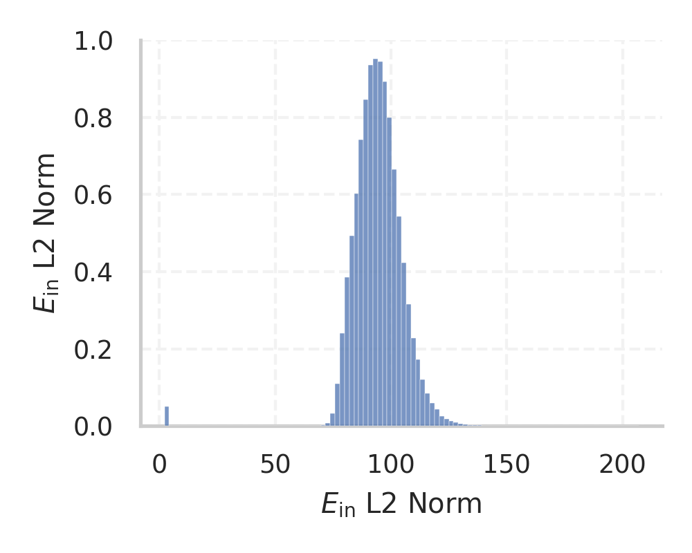
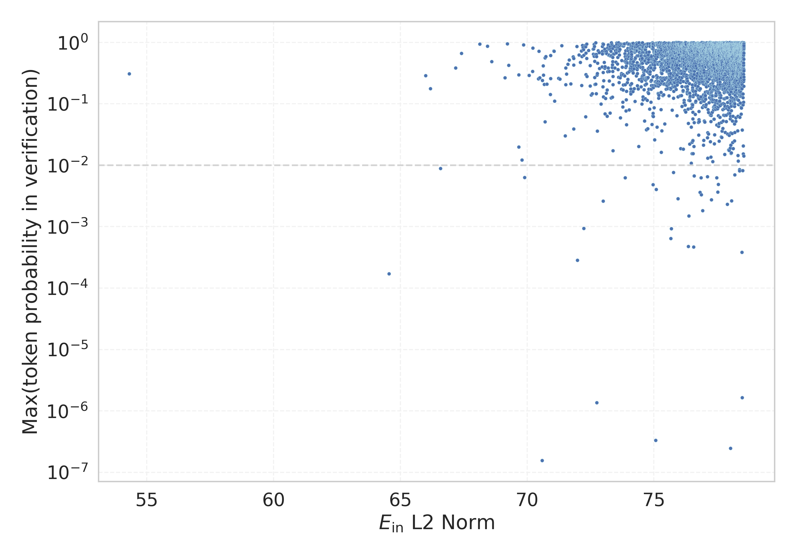

# Report for `openai/gpt-oss-120b`

## Model info

* Model Info: 
  * Tied embeddings: False
  * LM head uses bias: False
  * Embeddings shape: [201088, 2880]
* Tokenizer Info: 
  * Vocab Size: 200019
  * Tokenizer Class: PreTrainedTokenizerFast
  * Tokenizer Type: BPE
  * Bytes handling: Byte Input
  * Token for verification prompt building: abcdefghijklmnopqrstuvwxyz
  * Token id for verification prompt building: 161518
* Indicator summary: 
  * Indicator for under-trained tokens: E_{in} L2 Norm
  * Overall distribution: 94.403 +/- 11.197
* Detected Token Counts: 
  * Number of tested under-trained tokens: 3969, 3967 non-special, 37 below p = 0.01 threshold, 11 below soft indicator threshold
  * Number of single byte tokens: 256, of which 26 below indicator threshold
  * Number of special tokens: 21, of which 1 below indicator threshold
  * Number of non-single-byte unreachable tokens: 12, of which 0 below indicator threshold
  * Number of non-single-byte UTF-fragment tokens:  1434, of which 1 below soft indicator threshold

## Under-trained token indicators plot


## Verification plot


## Under-trained token verification results
11 entries below threshold of 69.225

|   token_id | token                    |   indicator | max_prob                                                         | in_other_tokens                                                                                                          |
|------------|--------------------------|-------------|------------------------------------------------------------------|--------------------------------------------------------------------------------------------------------------------------|
|      15362 | ````` ▁Short `````       |     54.3061 | <span style='border: 1px solid rgb(40, 167, 69);'>0.31</span>    | ````` ▁Shortly `````, ````` ▁Shorts `````, ````` ▁Shortcut `````                                                         |
|     193278 | ````` _REALTYPE `````    |     64.5496 | <span style='border: 1px solid rgb(169, 68, 66);'>0.00017</span> |                                                                                                                          |
|      22493 | ````` .gov `````         |     66.002  | <span style='border: 1px solid rgb(40, 167, 69);'>0.29</span>    |                                                                                                                          |
|      28231 | ````` .Core `````        |     66.1802 | <span style='border: 1px solid rgb(40, 167, 69);'>0.18</span>    |                                                                                                                          |
|     113550 | ````` ▁adipisicing ````` |     66.5785 | <span style='border: 1px solid rgb(255, 145, 0);'>0.0089</span>  |                                                                                                                          |
|      65359 | ````` ysz `````          |     67.1752 | <span style='border: 1px solid rgb(40, 167, 69);'>0.38</span>    | <span style='border: 1px solid rgb(40, 167, 69);'>````` yszer `````</span>, ````` ▁przysz `````, ````` ▁egyszer `````    |
|      34393 | ````` orch `````         |     67.4108 | <span style='border: 1px solid rgb(40, 167, 69);'>0.66</span>    | ````` ▁orchid `````, ````` ▁Torch `````, ````` ▁Porch `````, ````` ▁porch `````, ````` (torch `````, ...                 |
|       1427 | ````` uf `````           |     68.134  | <span style='border: 1px solid rgb(40, 167, 69);'>0.93</span>    | ````` aufnahme `````, ````` ▁Buffett `````, ````` \uff `````, ````` \tBuffered `````, ````` ▁Muff `````, ...             |
|     194409 | ````` antia `````        |     68.4385 | <span style='border: 1px solid rgb(40, 167, 69);'>0.86</span>    | ````` instantiate `````                                                                                                  |
|      51555 | ````` ắn `````           |     68.5993 | <span style='border: 1px solid rgb(40, 167, 69);'>0.49</span>    | ````` ▁thắng `````, ````` ắng `````, ````` ▁hắn `````, ````` ▁chắn `````, ````` ▁trắng `````                             |
|      28547 | ````` ifu `````          |     69.1285 | <span style='border: 1px solid rgb(40, 167, 69);'>0.27</span>    | ````` Beautiful `````, ````` ▁chifukwa `````, ````` ▁difusión `````, ````` ▁plentiful `````, ````` ▁Beautiful `````, ... |


## Tokens with partial UTF-8 sequences
1 entries below threshold of 69.225

|   token_id | token                      |   indicator | in_other_tokens                                          |
|------------|----------------------------|-------------|----------------------------------------------------------|
|      20373 | ````` <0xBE><0xB3>门 ````` |     2.40421 | ````` ▁澳门新 `````, ````` ▁澳门 `````, ````` 澳门 ````` |


## Byte tokens
26 entries below threshold of 76.586

|   token_id | token              |   indicator |   ord | hex   | byte_type   |
|------------|--------------------|-------------|-------|-------|-------------|
|        183 | ````` <0xFB> ````` |     2.11223 |   251 | 0xFB  | unused_utf8 |
|        177 | ````` <0xF5> ````` |     2.20687 |   245 | 0xF5  | unused_utf8 |
|        125 | ````` <0xC1> ````` |     2.24831 |   193 | 0xC1  | unused_utf8 |
|        180 | ````` <0xF8> ````` |     2.3373  |   248 | 0xF8  | unused_utf8 |
|        124 | ````` <0xC0> ````` |     2.36387 |   192 | 0xC0  | unused_utf8 |
|        178 | ````` <0xF6> ````` |     2.37069 |   246 | 0xF6  | unused_utf8 |
|        184 | ````` <0xFC> ````` |     2.41643 |   252 | 0xFC  | unused_utf8 |
|        181 | ````` <0xF9> ````` |     2.42177 |   249 | 0xF9  | unused_utf8 |
|        185 | ````` <0xFD> ````` |     2.49191 |   253 | 0xFD  | unused_utf8 |
|        179 | ````` <0xF7> ````` |     2.50115 |   247 | 0xF7  | unused_utf8 |
|        186 | ````` <0xFE> ````` |     2.5203  |   254 | 0xFE  | unused_utf8 |
|        182 | ````` <0xFA> ````` |     2.58486 |   250 | 0xFA  | unused_utf8 |
|        187 | ````` <0xFF> ````` |     2.58833 |   255 | 0xFF  | unused_utf8 |
|        110 | ````` <0xB2> ````` |    74.2861  |   178 | 0xB2  | utf8        |
|        246 | ````` <0x98> ````` |    74.2955  |   152 | 0x98  | utf8        |
|        238 | ````` <0x90> ````` |    74.7967  |   144 | 0x90  | utf8        |
|         96 | ````` <0xA3> ````` |    74.9173  |   163 | 0xA3  | utf8        |
|        248 | ````` <0x9A> ````` |    75.4018  |   154 | 0x9A  | utf8        |
|        236 | ````` <0x8E> ````` |    75.6425  |   142 | 0x8E  | utf8        |
|        112 | ````` <0xB4> ````` |    75.8803  |   180 | 0xB4  | utf8        |
<details><summary>6 additional entries below threshold</summary>

|   token_id | token              |   indicator |   ord | hex   | byte_type   |
|------------|--------------------|-------------|-------|-------|-------------|
|         99 | ````` <0xA6> ````` |     75.9266 |   166 | 0xA6  | utf8        |
|        249 | ````` <0x9B> ````` |     75.9705 |   155 | 0x9B  | utf8        |
|        107 | ````` <0xAF> ````` |     76.0636 |   175 | 0xAF  | utf8        |
|        247 | ````` <0x99> ````` |     76.169  |   153 | 0x99  | utf8        |
|        234 | ````` <0x8C> ````` |     76.2291 |   140 | 0x8C  | utf8        |
|        111 | ````` <0xB3> ````` |     76.5795 |   179 | 0xB3  | utf8        |
</details>


## Special tokens
1 entries below threshold of 76.586

|   token_id | token                             |   indicator | max_prob                                                         |
|------------|-----------------------------------|-------------|------------------------------------------------------------------|
|     200010 | ````` <\|reserved_200010\|> ````` |     72.2371 | <span style='border: 1px solid rgb(169, 68, 66);'>0.00093</span> |


## Unreachable tokens
0 entries below threshold of 76.586


